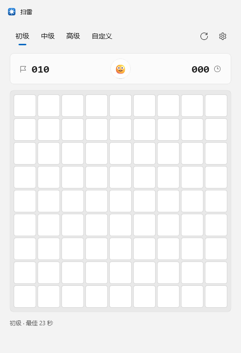
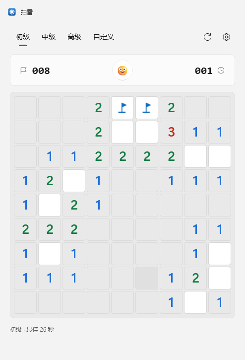
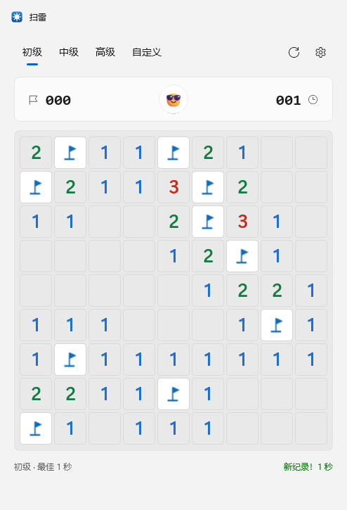
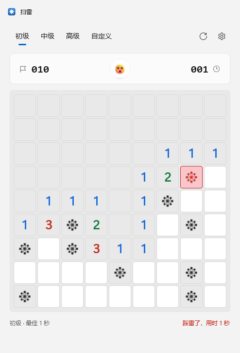
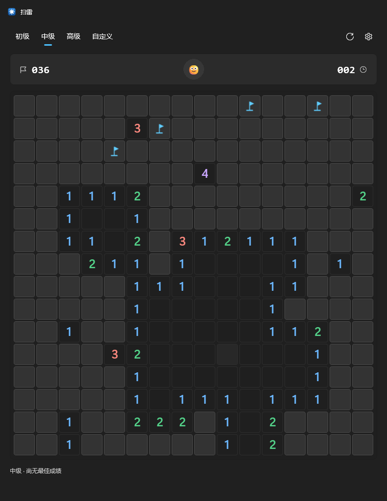
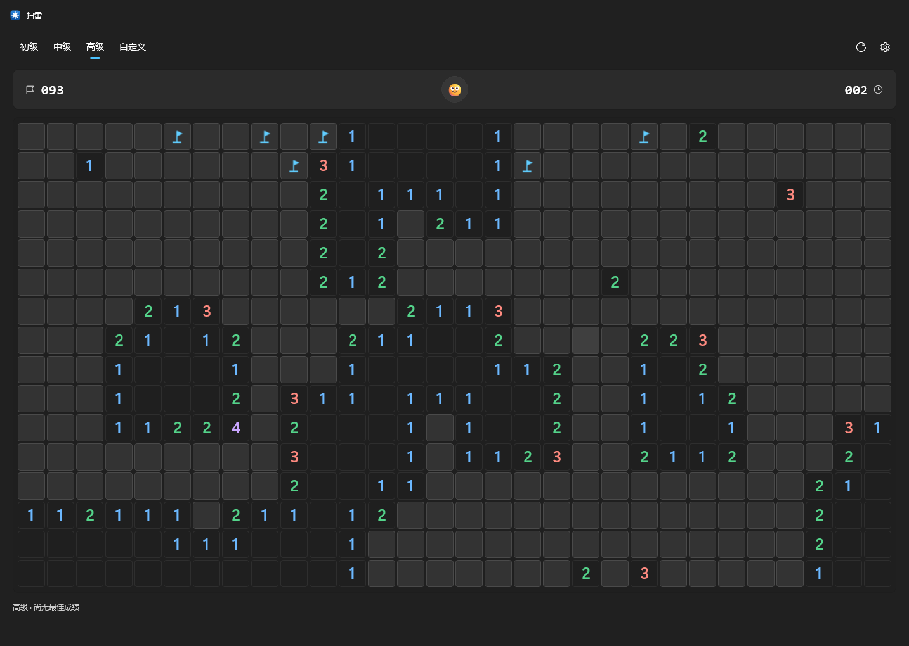

# Minesweeper · WinMine

English · [简体中文](README.zh-CN.md)

A faithful rebuild of classic Minesweeper on **WinUI 3 / Windows App SDK**, restyled after Windows 11 Fluent Design: Mica backdrop, custom title bar, rounded cards, Segoe Fluent Icons glyphs, and automatic light/dark theming.



| In progress (light) | Won (light) | Hit a mine (light) |
| --- | --- | --- |
|  |  |  |

| Intermediate (dark) | Expert (dark) | Custom board dialog |
| --- | --- | --- |
|  |  |  |

## Features

| Area | What it does |
| --- | --- |
| Gameplay | Left-click to reveal · right-click to flag · middle-click or re-click a revealed number to chord · the first click is always safe (3×3 protected area) |
| Keyboard | Arrow keys move the cursor; Space/Enter reveals or chords; `F` flags; `F2` / `Ctrl+N` restarts; `Ctrl+1/2/3` switches Beginner/Intermediate/Expert (no focus conflicts, and hovering the board never pops a key-tip bubble) |
| Difficulty | Beginner 9×9/10 mines, Intermediate 16×16/40 mines, Expert 16×30/99 mines, custom (3–40 columns, 3–30 rows; number boxes have no spin buttons — type a value and it is clamped to range) |
| HUD | Mines remaining, timer (0–999 s), face button (click to restart), best time |
| Appearance | Follows the system theme or an explicit choice; the window sizes itself to the board and re-centres; DWM caption buttons are recoloured to match the theme |
| Sound | Reveal / flood / flag / unflag / chord / explode / win, all PCM blocks synthesised at runtime; buttons and menus use WinUI's built-in `ElementSoundPlayer`; everything can be muted in Settings |
| Settings | Appearance (system / light / dark), sound toggle, reset best times, about |

## Build and run

Requires the .NET 10 SDK and Windows App Runtime 2.6 (`Microsoft.WindowsAppSDK 2.6.4`, framework-dependent).

```powershell
dotnet build WinMine.sln -c Release
dotnet run --project src/WinMine/WinMine.csproj
```

Executable (an unpackaged Win32 app — just double-click it):

```
src/WinMine/bin/x64/Release/net10.0-windows10.0.26100.0/win-x64/WinMine.exe
```

Publish a single-folder build:

```powershell
dotnet publish src/WinMine/WinMine.csproj -c Release -r win-x64 --self-contained false -o publish
```

## Project layout

```
WinMine.sln
src/WinMine.Core/            pure .NET game engine (no UI dependency, unit-testable)
  Cell.cs                    Cell / CellInfo / MoveResult / GameStatus
  Minefield.cs               board state machine: deferred mine placement, flood fill, flags, chording, win/lose
  Difficulty.cs              BoardPreset and DifficultyPresets
  BestTimes.cs               best times
  GameSettings.cs            JSON settings model
src/WinMine/                 WinUI 3 app
  MainWindow.xaml(.cs)       Fluent layout, title bar, timer, theming, menus
  MainWindow.Capture.cs      --capture DIR screenshot self-check
  MainWindow.SelfTest.cs     --selftest FILE interaction self-check
  Controls/BoardView.cs      custom-drawn board panel (input, animation, focus ring)
  Controls/CellVisual.cs     per-cell visual (rounded tile + vector flag/mine/wrong-flag)
  Controls/BoardPalette.cs   two-theme palette
  Views/CustomGameDialog.xaml custom board dialog
  Services/SettingsStore.cs  %LOCALAPPDATA%\WinMine\settings.json
  Services/GameSounds.cs     runtime-synthesised PCM + winmm PlaySound
  Services/UiSounds.cs       wrapper over WinUI's ElementSoundPlayer (Invoke/MoveNext/…)
tests/WinMine.Core.Tests/    28 xunit tests
tools/make-icon.ps1          generates Assets/winmine.png + winmine.ico
tools/set-repo-meta.ps1      sets repo description/topics through the REST API
tools/repo-description.txt   UTF-8 description text that script feeds to the API
```

## Verification

```powershell
# Engine unit tests (28)
dotnet test tests/WinMine.Core.Tests/WinMine.Core.Tests.csproj

# UI self-check: drives the real window and board control, writes a PASS/FAIL report
src/WinMine/bin/x64/Debug/net10.0-windows10.0.26100.0/win-x64/WinMine.exe --selftest artifacts/selftest.txt

# UI screenshots: renders 8 scripted states to PNG (no visible desktop required)
src/WinMine/bin/x64/Debug/net10.0-windows10.0.26100.0/win-x64/WinMine.exe --capture artifacts/shots
```

`--selftest` covers 68 checks: first-click safety, flood-fill extent, flag/unflag/reject-flag-on-revealed, chording, the timer actually ticking, auto-flagging plus best time on a win, all mines revealed and further input ignored after a loss, cell counts for all three presets and for custom boards, the window staying inside the work area, settings JSON round-trip, theme switching, the shortcuts plus "no accelerator key-tip source exists anywhere in the visual tree" (a regression guard for the F2 bubble that used to appear when hovering the board), the custom dialog's number-box state (all spin buttons hidden, values clamped), and audio (valid WAV headers, durations, a measured 880 Hz pitch, silence when muted, the audio device accepting playback, and WinUI control sounds being available).

The self-check also writes the 8 synthesised sounds to `audio/*.wav` next to the report so you can just listen to them — a copy lives in [docs/sounds](docs/sounds).

> If the dev machine sits in a locked session (RDP disconnected, etc.), `PrintWindow` / `CopyFromScreen` return no window pixels, so the self-check renders the real visual tree through in-app `RenderTargetBitmap` instead. Mica is a compositor backdrop and is not part of the XAML content, so screenshots substitute a near-solid background.

## Design notes

- **Engine and UI are separate**: `WinMine.Core` is a pure state machine; `BoardView` only paints `CellInfo` and translates mouse/keyboard input into `Reveal`/`ToggleFlag`/`Chord`, so the rules can be tested without any UI.
- **Custom-drawn board**: no `GridView`/`Button` — `BoardView` derives from `Panel` and arranges `CellVisual` instances by hand (9×9 up to 30×40, 1200 cells). That avoids control-template overhead and gives exact control over tile corner radius, spacing, hover/press scaling, and the staggered reveal animation.
- **Anti-cheat**: `Minefield.GetCell` only reports `IsMine` once the game is lost or that cell is revealed, so the UI cannot learn mine positions from data ahead of time; `BoardView` uses `IsMineAt` (the internal truth) only to decide whether to draw a mine icon on already-revealed cells.
- **Visual details**: tile corner radius 4, gap 3 (the gap shows the board background, which forms the grid lines), digits in `Segoe UI Variable Display` semibold using the classic palette (1 blue, 2 green, 3 red, 4 purple, 5 brown, 6 cyan, 7 black, 8 grey), remapped to high-contrast colours for the dark theme.
- **Window fitting**: on a difficulty change the cell size is probed from 46 px down to 18 px, the largest size that fits the work area wins, then the client area is resized and re-centred.
- **Shortcuts deliberately avoid `KeyboardAccelerator`**: when an accelerator is attached to the root element, WinUI pops a key-tip bubble ("F2") whenever the pointer hovers that element — which means the whole board. Window-level shortcuts therefore hook `KeyDown` on the root `Grid` with `handledEventsToo` and match `F2` / `Ctrl+N` / `Ctrl+1..3` themselves; they stay inert while a modal dialog is open.
- **Sound has two layers**: WinUI 3 does ship a control-sound library — `Microsoft.UI.Xaml.Controls.ElementSoundPlayer` with `Microsoft.UI.Xaml.ElementSoundKind` (the Fluent semantic sounds Invoke / Focus / Show / Hide / MoveNext …, with no gameplay sounds such as "explode" or "win", and only preset timbres). So buttons, menus and difficulty switches go through `ElementSoundPlayer`, while gameplay sounds are synthesised as PCM by `Services/GameSounds.cs` at startup and handed to `winmm!PlaySound(SND_MEMORY | SND_ASYNC)` — zero audio asset files, zero NuGet dependencies, tens of microseconds of click latency, and the blocks are pinned with `GCHandle` for the lifetime async playback needs.
