# 扫雷 · WinMine

简体中文 · [English](README.md)

用 **WinUI 3 / Windows App SDK** 复刻的经典扫雷，按 Windows 11 Fluent Design 重做界面：Mica 背景、自定义标题栏、圆角卡片、Segoe Fluent Icons 图标、浅色/深色主题自适应。

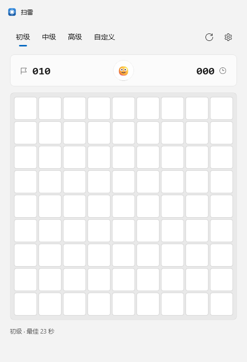

| 进行中（浅色） | 通关（浅色） | 踩雷（浅色） |
| --- | --- | --- |
| 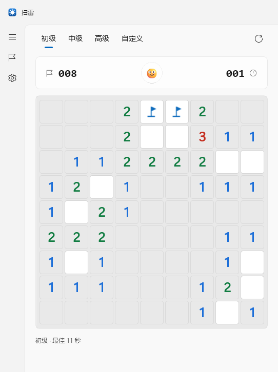 | 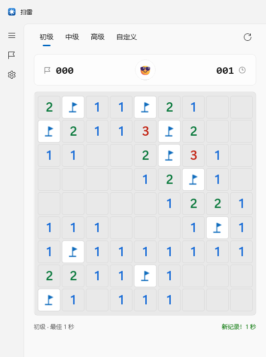 | 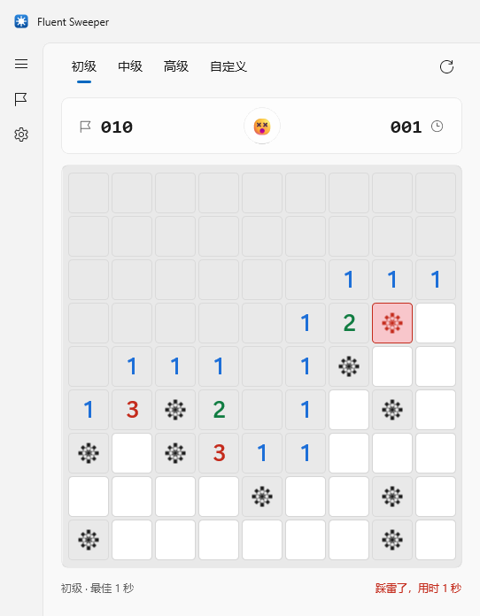 |

| 中级（深色） | 高级（深色） | 自定义棋盘对话框 |
| --- | --- | --- |
| 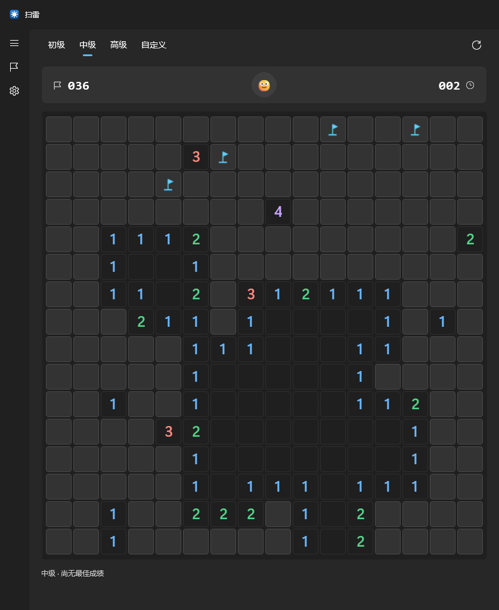 | 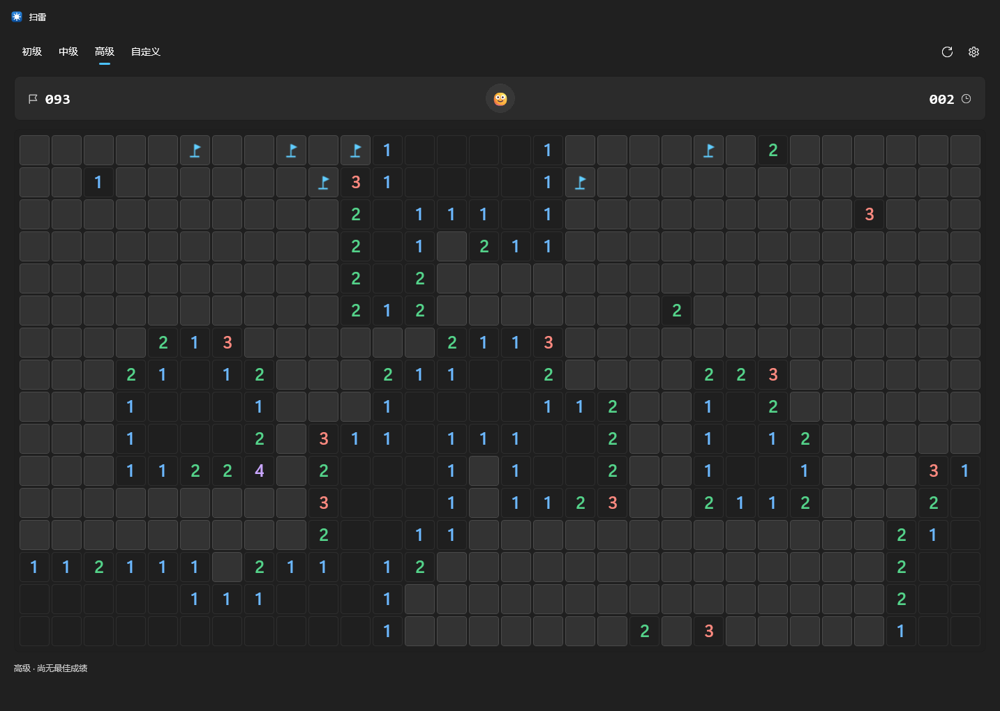 | 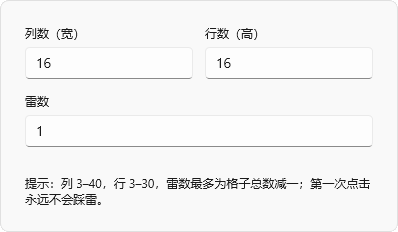 |

| 设置页（浅色） | 设置页（深色） |
| --- | --- |
| 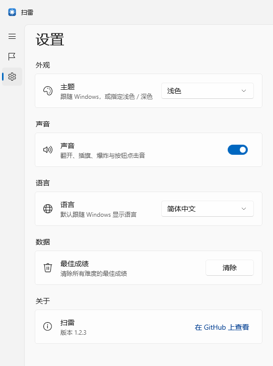 | 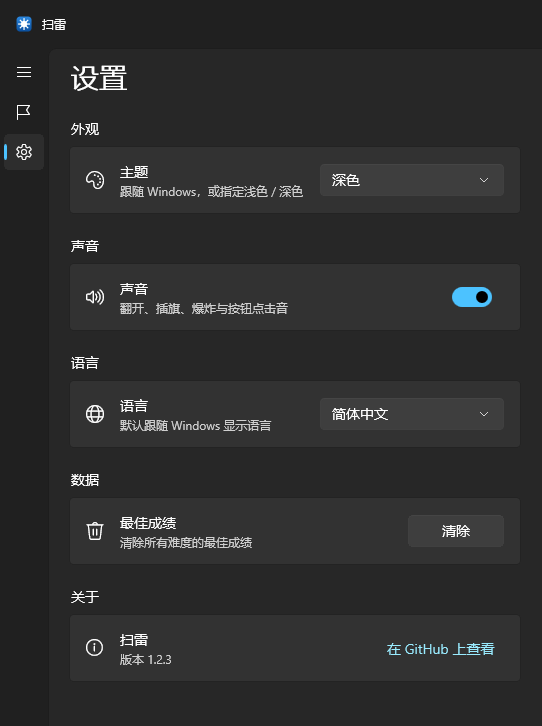 |

| 日本語 | English | Français | 한국어 |
| --- | --- | --- | --- |
| 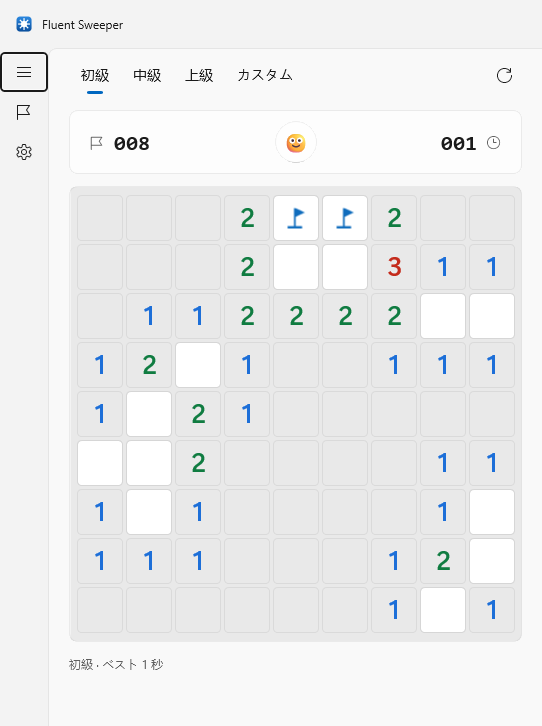 | 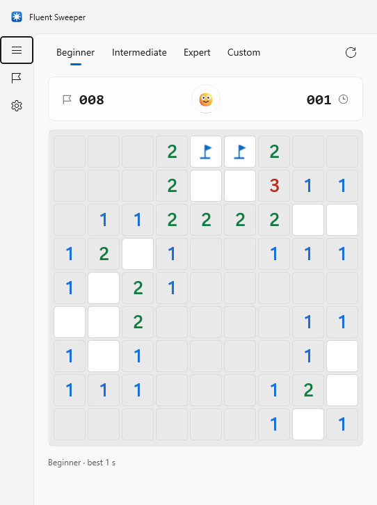 | 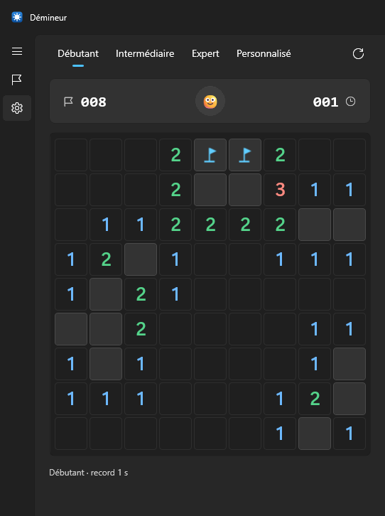 | 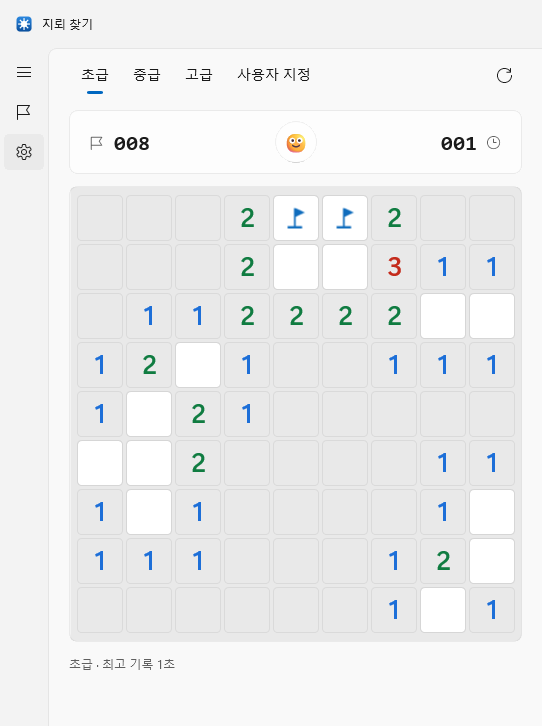 |

## 下载安装

最新版本在 [Releases](https://github.com/Churroser/winmine/releases/latest) 页面：

| 文件 | 是什么 | 前置条件 |
| --- | --- | --- |
| `WinMine-1.2.3-win-x64.zip` | 便携版：解压到任意目录，双击 `WinMine.exe` | 无（自包含：.NET 与 Windows App SDK 都在包里） |
| `WinMine-1.2.3-x64.msix` | 安装包：开始菜单项 + `WinMine.exe` 命令别名 | 需先信任随包的证书，见下 |
| `WinMine-msix-selfsigned.cer` | 给 MSIX 签名用的自签代码签名证书 | — |

MSIX 用的是自签证书（这里没有付费代码签名证书），所以 Windows 会在安装前提示。用**管理员** PowerShell 信任一次即可：

```powershell
Import-Certificate -FilePath .\WinMine-msix-selfsigned.cer -CertStoreLocation Cert:\LocalMachine\TrustedPeople
Add-AppxPackage .\WinMine-1.2.3-x64.msix              # 安装
```

装证书要进**受信任人（TrustedPeople）**，这是 AppX 真正校验签名证书的库；同时签名链必须能落到一个受信任的根，所以只能写机器级库——往 `Cert:\CurrentUser\TrustedPeople` 里导入（非管理员）仍然会报 `0x800B0109：应用包或捆绑包中的签名的根证书必须是受信任的证书`。图形界面的等价操作：双击 `.cer` → **安装证书** → **本地计算机** → **将所有证书放入下列存储** → **受信任人**。

只有导入过这张证书的机器才能装用它签的包，而且谁拿到配套私钥，就能签出那些机器都会信任的任何包——`.pfx` 按机密对待。批量部署可以走 Intune/GPO（计算机配置 → 策略 → Windows 设置 → 安全设置 → 公钥策略 → 受信任的发布者），或者在部署脚本里 `certutil -addstore TrustedPeople <cer>`。

包是自包含的，安装时**不会**再拉取 .NET 或 Windows App SDK 运行时。卸载用 `Remove-AppxPackage Churroser.WinMine` 或“设置 → 应用”。完全不想碰证书库的话，直接用 ZIP。

### 换成正式证书签名

自签证书只适合本地测试。正式分发时，Windows 必须能把你的签名链到一个它本来就信任的根：

| 路线 | 成本 | 说明 |
| --- | --- | --- |
| **Azure Artifact Signing**（原 Trusted Signing） | 约 $10/月 | 微软托管的云签名服务，证书约 3 天有效期、自动续签并时间戳到 `timestamp.acs.microsoft.com`；SmartScreen 信誉绑在已验证的发布者身份上。资格：美国/加拿大/欧盟/英国的组织且可验证纳税历史满 3 年，或美国/加拿大的个人开发者 |
| **OV / EV 代码签名证书**（DigiCert、Sectigo、GlobalSign、SSL.com、Certum…） | $300–500/年 | 根证书本来就在 Windows 信任列表里。2023 年 6 月起私钥必须在 FIPS 140-2 硬件令牌或 HSM 上，不再给 `.pfx`，改用 `signtool sign /sha1 <指纹>` 对着令牌签 |
| **Microsoft Store** | 免费（商店代签） | 把 MSIX 传到 Partner Center，商店会重新签名，你自己完全不需要证书。清单里的 `Identity/@Publisher` 必须等于 Partner Center 分配的标识（`CN=XXXXXXXX-…`） |

拿到证书后，清单里的 Publisher 和证书 Subject 必须逐字节一致：

```powershell
# 清单现在写的是
Select-String packaging\AppxManifest.xml -Pattern 'Publisher='

# 证书实际是什么（pfx，或已装进 CurrentUser\My 的令牌证书）
(Get-PfxCertificate .\mycert.pfx).Subject
```

然后用 `tools\make-msix.ps1` 重打包并签名——两种证书都支持，且永远会打时间戳，证书过期后包仍然可安装：

```powershell
powershell -File tools\make-msix.ps1 -SkipBuild -CertificateThumbprint <指纹>   # 令牌上的 OV/EV 证书
powershell -File tools\make-msix.ps1 -SkipBuild -CertificatePath .\mycert.pfx    # pfx 文件
```

走 Azure Artifact Signing 时 SignTool 需要它的 dlib 插件（`winget install -e --id Microsoft.Azure.ArtifactSigningClientTools`），签名命令是：

```powershell
signtool sign /fd SHA256 /tr http://timestamp.acs.microsoft.com /td SHA256 `
  /dlib "<dlib>\x64\Azure.CodeSigning.Dlib.dll" /dmdf metadata.json WinMine-1.2.3-x64.msix
```

完整对照见 [Sign an MSIX package](https://learn.microsoft.com/windows/msix/package/signing-package-overview)。

## 功能

| 分类 | 内容 |
| --- | --- |
| 玩法 | 左键翻开 · 右键插旗 · 中键或再次点击已翻开的数字快速展开（chord）· 第一次点击永远安全（3×3 保护区） |
| 键盘 | 方向键移动；空格/回车翻开或展开；`F` 插旗；`F2` / `Ctrl+N` 重开；`Ctrl+1/2/3` 切换初级/中级/高级（无焦点冲突，鼠标悬停棋盘不会弹出按键气泡） |
| 难度 | 初级 9×9/10 雷、中级 16×16/40 雷、高级 16×30/99 雷、自定义（列 3–40，行 3–30；输入框无上下箭头，直接键入数字，取值自动夹紧） |
| 状态栏 | 剩余雷数、计时器（0–999 秒）、表情按钮（点击重开）、最佳成绩 |
| 界面 | 自动跟随系统深浅色或手动指定；窗口按棋盘大小自适应并居中；DWM 标题栏按钮配色跟随主题 |
| 动效 | 瓷砖层用 Fluent 合成动画：翻开的格子淡入 + 0.9→1.0 缩放落位，按泛洪距离错开波次，大范围展开会向外荡开；插旗时旗子弹入；踩到的那颗雷脉冲一次 |
| 音效 | 翻开 / 泛洪 / 插旗 / 取消插旗 / 快速展开 / 爆炸 / 通关，全部为运行时合成的 PCM 音块；按钮与菜单用 WinUI 自带的 `ElementSoundPlayer`；可在设置里静音 |
| 设置 | 真正的设置页：左侧 `NavigationView` 窄栏（游戏 / 设置）切换，页内用 Windows 11 设置风格的 `SettingsCard` 分组——主题、音效、语言、最佳成绩、关于（版本号 + 仓库链接）；`Esc` 返回棋盘 |
| 多语言 | 简体中文、English、日本語、Français、한국어 —— 启动时按 Windows 显示语言自动选择，也可在“设置 → 语言”里固定；选择会持久化，窗口标题一并切换 |

## 构建与运行

需要 .NET 10 SDK 与 Windows App Runtime 2.6（`Microsoft.WindowsAppSDK 2.6.4`，非自包含）。

```powershell
dotnet build WinMine.sln -c Release
dotnet run --project src/WinMine/WinMine.csproj
```

可执行文件（非打包 Win32 应用，可直接双击）：

```
src/WinMine/bin/x64/Release/net10.0-windows10.0.26100.0/win-x64/WinMine.exe
```

发布单目录版本：

```powershell
dotnet publish src/WinMine/WinMine.csproj -c Release -r win-x64 --self-contained false -o publish
```

## 项目结构

```
WinMine.sln
src/WinMine.Core/            纯 .NET 游戏引擎（无 UI 依赖，可单元测试）
  Cell.cs                    Cell / CellInfo / MoveResult / GameStatus
  Minefield.cs               棋盘状态机：延迟布雷、泛洪、插旗、chord、胜负判定
  Difficulty.cs              BoardPreset 与 DifficultyPresets
  BestTimes.cs               最佳成绩
  GameSettings.cs            JSON 设置模型
  AppLanguage.cs             支持的界面语言 + 文化/ISO 解析
  BoardValidationError.cs    与语言无关的棋盘校验结果
src/WinMine/                 WinUI 3 应用
  MainWindow.xaml(.cs)       Fluent 布局、标题栏、计时、主题、导航、本地化接线
  MainWindow.Capture.cs      --capture DIR 截图自检
  MainWindow.SelfTest.cs     --selftest FILE 交互自检
  Controls/BoardView.cs      自绘棋盘面板（输入、动画、焦点环）
  Controls/CellVisual.cs     单格视觉（圆角瓷砖 + 矢量旗/雷/错旗）
  Controls/CellMotion.cs     Fluent 合成动画（翻开落位 / 旗子弹入 / 踩雷脉冲）
  Controls/BoardPalette.cs   双主题调色板
  Controls/SettingsCard.cs   Windows 11 设置行（图标 + 标题 + 说明 + 右侧控件）
  Views/CustomGameDialog.xaml 自定义棋盘对话框
  Views/SettingsPage.xaml(.cs) 设置页：外观 / 声音 / 语言 / 数据 / 关于
  Services/SettingsStore.cs  %LOCALAPPDATA%\WinMine\settings.json
  Services/Localization.cs   内置 5 张字符串表 + Loc.T/Loc.F
  Services/GameSounds.cs     运行时合成的 PCM 音效 + winmm PlaySound
  Services/UiSounds.cs       WinUI 自带 ElementSoundPlayer 包装（Invoke/MoveNext…）
tests/WinMine.Core.Tests/    54 个 xunit 测试（规则、设置、语言解析）
tools/make-icon.ps1          生成 Assets/winmine.png + winmine.ico
tools/make-package-assets.ps1  从图标派生 MSIX 需要的磁贴/启动图 PNG
tools/make-msix.ps1          构建、打包、签名 MSIX（并输出便携 ZIP）；-TestInstall 会实测安装
tools/set-repo-meta.ps1      通过 REST API 设置仓库 description / topics
tools/repo-description.txt   给上面那个脚本读的 UTF-8 描述文案
packaging/AppxManifest.xml   MSIX 身份、磁贴资源、命令别名、runFullTrust 能力
packaging/Assets/            StoreLogo / Square44x44Logo / Square150x150Logo / Wide310x150Logo / SplashScreen
```

## 验证

```powershell
# 引擎单元测试（54 项）
dotnet test tests/WinMine.Core.Tests/WinMine.Core.Tests.csproj

# 界面自检：驱动真实窗口与棋盘控件，输出 PASS/FAIL 报告
src/WinMine/bin/x64/Debug/net10.0-windows10.0.26100.0/win-x64/WinMine.exe --selftest artifacts/selftest.txt

# 界面截图：把脚本化的 14 个状态渲染成 PNG（不需要可见桌面）；--lang 指定整套截图的界面语言
src/WinMine/bin/x64/Debug/net10.0-windows10.0.26100.0/win-x64/WinMine.exe --capture artifacts/shots-zh --lang zh-Hans
src/WinMine/bin/x64/Debug/net10.0-windows10.0.26100.0/win-x64/WinMine.exe --capture artifacts/shots-en --lang en
```

本页截图放在 [docs/screenshots/zh](docs/screenshots/zh)，英文版 README 用的是 [docs/screenshots/en](docs/screenshots/en)。

`--selftest` 覆盖 109 项检查：首点安全、泛洪范围、插旗/取消插旗/已翻开格拒绝插旗、chord 展开、计时器走动、通关自动插旗与最佳成绩、踩雷揭示全部地雷与拒绝后续操作、三档难度与自定义棋盘的格子数量、窗口不超出工作区、设置 JSON 往返、主题切换，快捷键与“棋盘自身不存在加速键提示源”（专门守住“悬停棋盘冒出 F2 气泡”这个回归），自定义棋盘对话框的输入框状态（全部隐藏上下箭头、取值区间受控），设置页（导航栏两页、切页可见性、控件反映已保存设置、改主题/音效即时生效、关于行版本号在应用名下方、切换语言后收起状态的下拉框显示文本也刷新，展开下拉时同样不崩），动效（波次延迟单调且有上限、翻开/插旗/踩雷三种合成动画确实启动、没有抛异常——`ElementCompositionPreview` 对使用了 `CenterPoint` 的元素会拒绝给出 visual——以及重绘后每格回到 opacity 1 / scale 1），音效（WAV 头合法、时长、880 Hz 音高实测、静音后不输出、音频设备接受播放、WinUI 控件音效可用），以及多语言（5 张表键集一致且无空值、占位符跨语言一致、`zh-CN`/`zh-TW`/`ja`/`fr-CA`/`ko`/`en-GB`/`de-DE`/不变文化都能正确回退、显式选择优先于系统语言、并且窗口标题/标题栏文案/难度页签/棋盘无障碍名/导航栏/设置页/页脚/状态行/对话框与校验文案确实都换成了新语言）。

自检还会把 8 个合成音效写到报告旁的 `audio/*.wav`，方便直接试听——仓库里也放了一份在 [docs/sounds](docs/sounds)。

> 开发机若处于锁屏（Remote Desktop 断开等）会话，`PrintWindow` / `CopyFromScreen` 拿不到窗口像素，因此自检改用应用内 `RenderTargetBitmap` 渲染真实视觉树；Mica 属于合成器背景、不在 XAML 内容里，截图时用近似纯色背景替代。

## 设计说明

- **引擎与界面分离**：`WinMine.Core` 是纯状态机，`BoardView` 只负责把 `CellInfo` 画出来并把鼠标/键盘翻译成 `Reveal`/`ToggleFlag`/`Chord`，因此规则可以脱离 UI 测试。
- **自绘棋盘**：不用 `GridView`/`Button`，而是继承 `Panel` 手工布置 `CellVisual`（9×9 到 30×40 共 1200 格）——没有控件模板开销，且能精确控制瓷砖圆角、间距、悬停/按下缩放与逐格揭晓动画。
- **防作弊**：`Minefield.GetCell` 只在失败或该格已揭示时返回 `IsMine`，界面无法通过数据提前得知雷的位置；`BoardView` 另用 `IsMineAt`（内部真值）决定揭示态下的雷图标。
- **视觉细节**：瓷砖圆角 4、间隙 3（间隙露出棋盘底色，形成网格线）、数字使用 `Segoe UI Variable Display` 半粗体并按经典配色（1 蓝 2 绿 3 红 4 紫 5 棕 6 青 7 黑 8 灰），深色主题重新映射为高对比色。
- **窗口自适应**：换难度时从 46px 到 18px 逐档试探格子尺寸，取能塞进工作区的最大值后重设窗口客户区并居中。
- **快捷键不走 `KeyboardAccelerator`**：`KeyboardAccelerator` 挂在根元素上时，WinUI 会在指针悬停该元素（包括整个棋盘）时弹出按键气泡（显示 “F2”）。所以窗口级快捷键改为在根 `Grid` 上挂 `KeyDown`（`handledEventsToo`），自行判断 `F2` / `Ctrl+N` / `Ctrl+1..3`；模态对话框打开期间不响应。
- **多语言不走 PRI**：非打包应用没有包标识，`ResourceLoader`/`.resw`（以及它需要的 `MakePri` 接线）成本高于收益。改为 `Services/Localization.cs` 内置五张完整字符串表，对外只暴露 `Loc.T(key)` / `Loc.F(key, args)`；语言判定放在核心库（`AppLanguage` + `LanguageResolver`：`zh-Hans`、`ja`、`fr`、`ko`、`en`，其它一律回退英文），再由 `ApplyLocalization()` 把字符串灌进具名控件。核心库只返回与语言无关的 `BoardValidationError` 枚举，校验逻辑可单测、提示文案由调用方本地化。
- **动效跑在合成器上**：瓷砖反馈用 `ElementCompositionPreview.GetElementVisual` + 关键帧动画（`Controls/CellMotion.cs`），不用 `Storyboard`——300+ 格的泛洪也在合成线程上跑，不需要 `EnableDependentAnimation`。波次是相对点击格的 BFS 距离（间隔 16 ms、上限 192 ms），所以一次大展开是“涟漪”而不是“整块一闪”。有个坑：元素一旦用了 `UIElement.CenterPoint`，再调 `GetElementVisual` 会抛 `拒绝访问 … this object currently has the CenterPoint property in use`。因此瓷砖把“按下缩放”的重心留在外层 `Root`，动画则施加在干净的内层 `Surface` 上，重心改在合成 visual 上设置；`--selftest` 会断言三种动画确实启动过，防止它悄悄退化成“完全没动画”。
- **音效分两层**：WinUI 3 确实自带控件音效库 `Microsoft.UI.Xaml.Controls.ElementSoundPlayer` + `Microsoft.UI.Xaml.ElementSoundKind`（Fluent 的 Invoke / Focus / Show / Hide / MoveNext … 语义音，没有“爆炸”“胜利”这种玩法音，且只能选预设音色）。所以按钮、菜单、难度切换交给 `ElementSoundPlayer`，玩法音效则由 `Services/GameSounds.cs` 在启动时合成 PCM 并交给 `winmm!PlaySound(SND_MEMORY | SND_ASYNC)` 播放——零音频资源文件、零 NuGet 依赖，点击延迟只有几十微秒，音块用 `GCHandle` 永久钉住以满足异步读取的生命周期。
